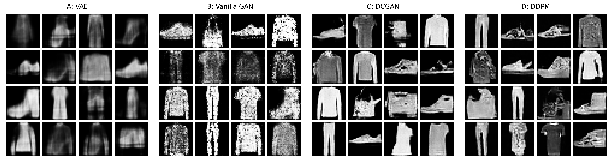

# Comparative Study of Generative Models on Fashion-MNIST

Six generative models are trained and evaluated under one protocol on Fashion-MNIST: a Vanilla Autoencoder, a Sparse Autoencoder, a Variational Autoencoder (VAE), a Vanilla GAN, a DCGAN and a Denoising Diffusion Probabilistic Model (DDPM). A separate experiment with an MLP classifier shows why a classifier's weights and features cannot be turned back into new images.

## Results

Measured on the 7,000 test images. The table is `outputs/metrics/results.csv`.

| Model | Parameters | Time / epoch (s) | Latency (ms / 64 images) | MSE ↓ | PSNR (dB) ↑ | SSIM ↑ | FID ↓ |
|---|---|---:|---:|---:|---:|---:|---:|
| MLP + frozen decoder | 0.22M + 0.22M | 5.04 | 0.19 | 0.0166 | 18.50 | 0.703 | 150.6\* |
| Vanilla AE | 0.44M | 4.68 | 0.16 | 0.0097 | 21.05 | 0.805 | 158.1\* |
| Sparse AE (λ = 1e-4) | 0.44M | 4.84 | 0.16 | 0.0106 | 20.61 | 0.783 | 157.5\* |
| VAE | 0.45M | 4.88 | 0.08 | 0.0139 | 19.37 | 0.753 | 101.3 |
| Vanilla GAN | 1.49M G + 0.53M D | 4.99 | 0.29 | – | – | – | 140.4 |
| DCGAN | 0.78M G + 0.14M D | 8.85 | 1.26 | – | – | – | **29.0** |
| DDPM | 1.34M | 56.93 | 22,303 | – | – | – | 34.0 |

\* These models have no prior to sample from, so their samples come from a Gaussian fitted to their test-set latents. Treat their FID as supplementary.

The MLP classifier (784 → 256 → 64 → 10) reaches 89.29% test accuracy.



## Repository layout

```
.
├── main.ipynb          the whole study, run from top to bottom
├── requirements.txt    pinned package versions
├── src/
│   ├── data.py         Fashion-MNIST download, stratified 80/10/10 split, DataLoaders
│   ├── train.py        training loops: classifier, fit() for the AE family and DDPM, train_gan()
│   ├── metrics.py      reconstruction metrics (MSE, PSNR, SSIM), FID, latency
│   └── utils.py        paths, device, set_seed(), history files, image grids
├── data/               Fashion-MNIST, downloaded on the first run (not in git)
└── outputs/
    ├── checkpoints/    model weights, *.pt (not in git; the notebook recreates them)
    ├── histories/      loss and time per epoch for each model (JSON)
    ├── samples/        GAN and DCGAN samples from the same fixed noise after every epoch
    ├── figures/        report figures and the plots of each notebook section
    └── metrics/        result tables (CSV, JSON)
```

Each model class is defined in the notebook, in that model's section, next to its explanation. `src/` holds the code that all models share.

## Setup

```bash
git clone https://github.com/1loral1/generative-model-comparison-study.git
cd generative-model-comparison-study
conda create -n genmodels python=3.12 -y
conda activate genmodels
pip install -r requirements.txt
```

`requirements.txt` installs the CUDA 12.6 build of PyTorch. On a machine without an NVIDIA GPU, first delete its `--extra-index-url` line and the `+cu126` suffixes, as the comment at the top of the file says. The code uses the GPU whenever PyTorch can see one (`DEVICE` in `src/utils.py`). To check:

```bash
python -c "import torch; print(torch.cuda.is_available())"
```

A GPU is strongly recommended. On the test laptop's CPU, one batch of 64 DDPM images takes an estimated 3 minutes (1,000 denoising steps), so its 5,000 FID samples alone would take about 4 hours.

## Running

Open `main.ipynb` in VS Code (Python and Jupyter extensions) or in JupyterLab (`pip install jupyterlab`), select the `genmodels` environment as the kernel, and run all cells in order. Keep the notebook in the repository root, because its cells import from `src/`.

To run it without opening it:

```bash
pip install nbconvert
jupyter nbconvert --to notebook --execute --inplace --ExecutePreprocessor.timeout=-1 main.ipynb
```

The first run downloads two things:

- **Fashion-MNIST** (about 30 MB) into `data/`, through torchvision.
- **The Inception-v3 weights for FID** (`weights-inception-2015-12-05-6726825d.pth`, about 96 MB) into the PyTorch cache, `~/.cache/torch/hub/checkpoints/` (on Windows `%USERPROFILE%\.cache\torch\hub\checkpoints\`), when the FID cell first runs. If that download fails, for example with an SSL error, download the file yourself from <https://github.com/toshas/torch-fidelity/releases/download/v0.2.0/weights-inception-2015-12-05-6726825d.pth> and put it in that folder.

A full run took 93 minutes on the RTX 2050:

| Part | Time |
|---|---:|
| MLP classifier and the frozen-encoder decoder (20 epochs each) | 3.5 min |
| Vanilla AE, Sparse AE for 3 values of λ, VAE (20 epochs each) | 9 min |
| Vanilla GAN and DCGAN (50 epochs each) | 11.5 min |
| DDPM training (30 epochs) | 30 min |
| DDPM sampling and its mode-coverage check | 6.5 min |
| FID of 7 models, 5,000 samples each (most of it is DDPM sampling) | 32 min |
| All other cells | 1 min |

Everything fits in 4 GB of GPU memory: FID sends images through Inception in chunks of 100.

## Experimental protocol

The same settings hold for every model:

- **Data.** The 60,000 training and 10,000 test images of Fashion-MNIST are merged, then split 80/10/10, stratified by class, with `random_state=42`: 56,000 for training, 7,000 for validation and 7,000 for testing. Every model uses this split, and every test number comes from the same 7,000 images.
- **Seed.** `set_seed(42)` seeds Python, NumPy and PyTorch (CPU and CUDA). It runs at the start and again before every training run and sampling step, so each model starts from the same random state whatever ran before it.
- **Batches.** 256 images. The training loader is shuffled; the validation and test loaders are not.
- **Pixel range.** [0, 1] for the MLP and the autoencoders (Sigmoid output), [−1, 1] for the GANs (Tanh output) and the DDPM. Images are mapped back to [0, 1] for every metric.
- **Checkpoints.** Models with a validation set score keep their best epoch: the classifier by validation accuracy, the autoencoders, VAE and DDPM by validation loss. The GANs have no validation loss, so the final generator is kept, plus a snapshot every 10 epochs.

| Model | Architecture | Loss | Optimizer | Epochs |
|---|---|---|---|---:|
| MLP classifier | 784 → 256 → 64 → 10, ReLU | cross-entropy | Adam, lr 1e-3 | 20 |
| MLP + frozen decoder | frozen classifier layers 784 → 256 → 64, trained decoder 64 → 256 → 784 | MSE | Adam, lr 1e-3 | 20 |
| Vanilla AE | 784 → 256 → 64 → 256 → 784, ReLU, Sigmoid output | MSE | Adam, lr 1e-3 | 20 |
| Sparse AE | same as the Vanilla AE | MSE + λ‖h‖₁ for λ ∈ {1e-5, 1e-4, 1e-3} | Adam, lr 1e-3 | 20 per λ |
| VAE | 784 → 256 → μ and log σ² (64 each) → 256 → 784 | BCE + KL divergence | Adam, lr 1e-3 | 20 |
| Vanilla GAN | G: 100 → 256 → 512 → 1024 → 784, Tanh output. D: 784 → 512 → 256 → 1. LeakyReLU | BCE, non-saturating generator loss | Adam, lr 2e-4, β = (0.5, 0.999) | 50 |
| DCGAN | G: 100 → 128 × 7 × 7 → 64 × 14 × 14 → 1 × 28 × 28 with transposed convolutions and BatchNorm. D: strided convolutions 28 × 28 → 14 × 14 → 7 × 7 → 1, LeakyReLU | same as the Vanilla GAN | same as the Vanilla GAN | 50 |
| DDPM | small U-Net (28 → 14 → 7 and back, skip connections, sinusoidal time embedding). T = 1,000 steps, β rising linearly from 1e-4 to 0.02 | MSE on the predicted noise | Adam, lr 2e-4 | 30 |

The Sparse AE reported everywhere uses λ = 1e-4. That λ gives the lowest reconstruction MSE among the values that make the code sparser than the Vanilla AE's.

How each quantity is measured:

- **Reconstruction** (autoencoders and MLP + frozen decoder): pixel MSE, PSNR and SSIM on the 7,000 test images.
- **FID:** 5,000 generated images are compared with the 7,000 test images using 2,048-dimensional Inception-v3 features (torchmetrics with torch-fidelity). The grayscale images are repeated to 3 channels. The VAE, both GANs and the DDPM sample from N(0, I).
- **Latency:** the mean time to generate one batch of 64 images over 20 runs, after 3 warm-up runs, with CUDA synchronized. For the DDPM this includes all 1,000 denoising steps.
- **Mode coverage:** the trained MLP classifier labels 5,000 samples from each GAN and 1,000 from the DDPM, to show which classes a generator misses.
- **Anomaly detection:** simulated 6 × 6 defect (a hole or a stain), scored by reconstruction error (AUROC). Latency on the laptop CPU, at batch sizes 1 and 64, stands in for a phone.

## Reproducibility notes

- The model weights are not in the repository, so running the notebook retrains every model. Later cells use models trained earlier in the same session, so run the notebook from the top.
- cuDNN is not forced into deterministic mode, so a run on another GPU or driver version can give slightly different numbers.

## References

- H. Xiao, K. Rasul, R. Vollgraf. Fashion-MNIST: a Novel Image Dataset for Benchmarking Machine Learning Algorithms. arXiv:1708.07747, 2017.
- D. P. Kingma, M. Welling. Auto-Encoding Variational Bayes. ICLR 2014.
- I. Goodfellow et al. Generative Adversarial Nets. NeurIPS 2014.
- A. Radford, L. Metz, S. Chintala. Unsupervised Representation Learning with Deep Convolutional Generative Adversarial Networks. ICLR 2016.
- J. Ho, A. Jain, P. Abbeel. Denoising Diffusion Probabilistic Models. NeurIPS 2020.
- M. Heusel et al. GANs Trained by a Two Time-Scale Update Rule Converge to a Local Nash Equilibrium. NeurIPS 2017.
